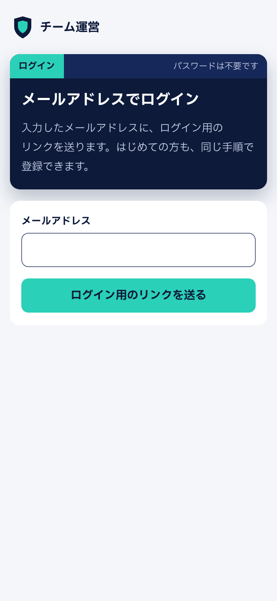
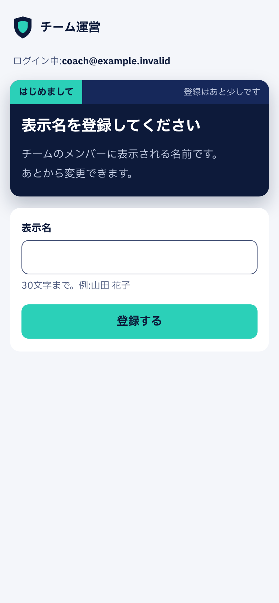
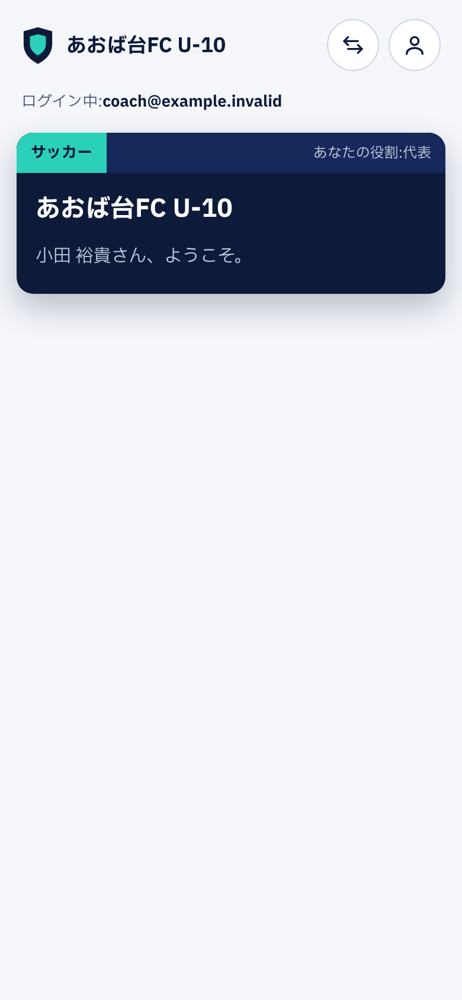
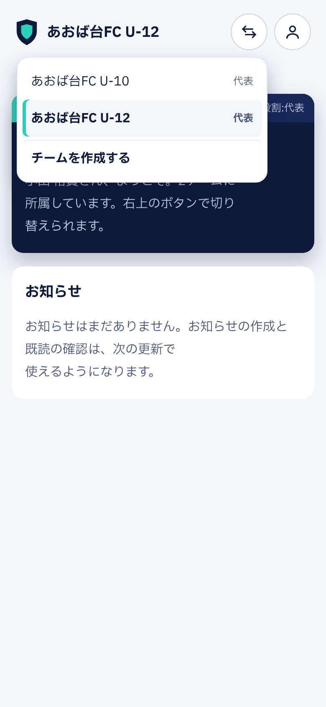

# team-ops-web

少年スポーツチーム運営ツールのWeb画面です。保護者や役員がスマホのブラウザから使うことを前提にしています。

> **現在の状況(2026年11月):第1弾の機能 001〜007 の画面が完成**
> アカウントとチーム作成、招待と参加承認、名簿(CSV の一括登録)、役割と権限・監査ログ、お知らせ(予約送信)、既読と配信状況・再通知、デモモード
> システム全体の要件・設計判断・機能仕様と、ローカル環境の起動方法は [team-ops](https://github.com/yuukioda999/team-ops) にまとめています。

| ログイン | 表示名の登録 | チームのホーム | チームの切り替え |
|---|---|---|---|
|  |  |  |  |

## 技術

- React 19 + TypeScript + Vite、ルーティングは React Router
- API の型は team-ops-api の OpenAPI から生成する(`npm run gen:api`)。手書きしない。CI で生成結果が最新かを確かめる
- API クライアントは openapi-fetch。Sanctum の SPA 認証(Cookie のセッションと CSRF トークン)に対応
- 画面のテストは Vitest + Testing Library。利用者に見える文言とロールで要素を探し、テスト名に受け入れ基準のIDを入れる
- デザインは「マッチセンター」(team-ops の ADR-0007)。色・書体・角丸は `src/styles/tokens.css` の変数だけを使う

## 構成

```
src/
  api/          生成した型(schema.d.ts)と API クライアント
  components/   共通部品(パネル、入力欄、メッセージ、画面の枠)
  features/
    auth/       ログイン、表示名、アカウント設定、メール変更
    teams/      チームの作成、ホーム、切り替え
  routes.tsx    画面の一覧
deploy/         本番の nginx 設定(/api を同じオリジンで API に転送)
```

## ライセンス

[MIT](LICENSE)
